 

 
 

<a href="https://huggingface.co/R0U5">

 

## Quick Stats

## Toolbox

## Featured Public Work

<table>
<tr>
<td width="33%" valign="top" align="center">

### <a href="https://github.com/R0U5/Electric-Sheep">Electric-Sheep</a>

Every night an autonomous AI agent finds a limitation in its own cognition, builds a working fix, deploys it to its live infrastructure, and publishes what it learned. A long-running experiment in machine self-improvement - 60+ self-built cognitive subsystems.

`HTML` `Agent` `Frontier Systems`

</td>
<td width="33%" valign="top" align="center">

### <a href="https://github.com/R0U5/Lethe">Lethe</a>

Model-agnostic abliteration toolkit for Hugging Face causal LMs. Refusal directions computed and removed via weight orthogonalization or runtime hooks, with KL-aware tuning and a local web UI.

`Python` `LLM` `Alignment`

</td>
<td width="33%" valign="top" align="center">

### <a href="https://github.com/R0U5/Reforge">Reforge</a>

A modular LoRA fine-tuning pipeline for Hugging Face models. Data cleaning, smart early stopping, automatic mode detection, and cross-platform support in one flow.

`Python` `Fine-tuning` `ML`

</td>
</tr>
</table>
